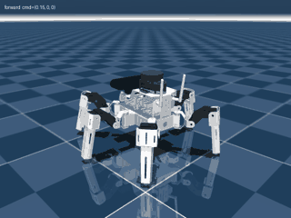

# MUTO RS hexapod: walking with RL in MuJoCo



Reinforcement-learning locomotion for the Yahboom MUTO RS (18-DOF hexapod), trained in MuJoCo with
PPO and exported to ONNX for the real robot's ROS 2 policy node. (The earlier Isaac Lab version lives in `../MUTO_RL/`.)

The policy walks on velocity commands (forward, sideways, turn) with a tripod gait; a zero command
means stand still in Yahboom's standby pose. It's trained with the real robot's limits in mind:
no joint-angle feedback, 25 Hz IMU, 1° servo commands, latency, and randomized mass, servos and friction.

## Status

Current policy (v4, simulation, randomized robot, no pushes):

| Command | Target | Achieved |
|---|---|---|
| stand still | 0 | stands still (joints move < 0.3°) |
| forward / backward | ±0.15 m/s | +0.134 / −0.128 m/s |
| slow forward | 0.07 m/s | 0.071 m/s |
| sideways | 0.10 m/s | 0.099 m/s |
| turn left / right | ±0.6 rad/s | +0.50 / −0.58 rad/s |
| straight-line drift, with heading hold | 0 | ~1° per 10 s |
| falls | 0 | 0 |

Not tested on the real robot yet. The biggest open question is the real servo response time.

## Setup

```bash
cd muto_mujoco
uv sync                                   # creates .venv with mujoco and the RL libraries
uv run python tools/prepare_meshes.py     # copies the robot meshes into assets/meshes/ (not in git)
uv run python tools/build_mjcf.py         # regenerates model/muto.xml
```

## Look at the robot

```bash
uv run python -m mujoco.viewer --mjcf model/scene.xml
```

In the viewer: double-click a body to select it, Ctrl+right-drag to push it,
the *Control* panel on the right has a slider per servo. Press `3` to show
collision shapes, `2` to hide meshes.

## Train, watch, evaluate, export

```bash
uv run python train.py                                # PPO on 6 CPU processes, ~50 min for 5M steps
uv run python train.py --init runs/<run>/final.zip    # continue from a trained policy
uv run tensorboard --logdir runs                      # progress at http://localhost:6006
uv run python play.py runs/<run>/final.zip            # viewer: arrows / , . to steer, space to stand
uv run python tools/evaluate.py runs/<run>/final.zip  # speed achieved per command, drift, falls
uv run python tools/record.py runs/<run>/final.zip out.gif
uv run python export_onnx.py runs/<run>/final.zip     # -> final.onnx for the robot's muto_policy node
```

Training outputs go to `runs/` (not in git).

## Policy interface (what the robot side must reproduce)

Documented at the top of `muto_env/env.py` and embedded in the exported ONNX as metadata (`muto_interface`).

- **Input (29):** gravity direction in the body frame from the IMU orientation (3) | gyro × 0.25 (3) |
  previous action (18) | command / [0.15, 0.10, 0.6] (3) | gait clock sin, cos of 2π·2 Hz·t (2),
  set to (0, 0) when the command is zero.
- **Output (18):** joint target = home pose + 0.3 rad × action, in servo-ID order, converted to servo
  degrees and rounded (see `muto_env/robot.py`), sent at 50 Hz.
- **No joint angles in the input:** the real servo bus can't read them at 50 Hz.
- **Heading hold:** when the turn command is zero, run `turn_cmd = 2 · (target_yaw − imu_yaw)` outside
  the policy, as `play.py` does. Without it the robot drifts ~20° per 10 s.

## Files

| Path | What |
|---|---|
| `model/muto.xml` | robot + `home` keyframe (Yahboom standby pose); generated, don't edit by hand |
| `model/scene.xml` | floor and light; includes `muto.xml` |
| `assets/meshes/` | full-detail STL meshes; ones over MuJoCo's 200k-face limit are split into `_0`, `_1`, … chunks |
| `tools/prepare_meshes.py` | rebuilds `assets/meshes/` from `../assets/yahboomcar_description/meshes/` |
| `tools/build_mjcf.py` | rebuilds `model/muto.xml` from `muto_des.urdf`; servo model and masses live here, each value marked DATASHEET or ESTIMATE |
| `tools/render.py` | saves a PNG (visual + collision view) |
| `tools/evaluate.py` / `tools/record.py` | command-tracking numbers / GIF of a policy |
| `muto_env/robot.py` | real-robot facts: servo-ID order, servo↔URDF angle conversion, rates |
| `muto_env/env.py` | Gymnasium environment: observation/action interface, rewards, randomization |
| `train.py` / `play.py` / `export_onnx.py` | train with PPO / watch and steer / export to ONNX |
| `docs/walk.gif` | the GIF above |

After a new SolidWorks export: `uv run python tools/prepare_meshes.py && uv run python tools/build_mjcf.py`.

## Robot facts used

- Leg names are pinyin: **z** = 左 left (+y), **y** = 右 right (−y); **q** front, **z** middle, **h** rear.
  Joint 1 = hip yaw, 2 = hip pitch, 3 = knee.
- Actuators are ordered by real servo ID (from Yahboom's MutoLib): 1–3 `yq`, 4–6 `yz`, 7–9 `yh`,
  10–12 `zh`, 13–15 `zz`, 16–18 `zq`.
- Servo: Yahboom 35 kg bus servo, 7.4 V: stall 3.43 N·m, no-load 0.22 s/60°, 61.5 g, software range ±90°.
  The CAD has no servo masses; the builder adds them (model total 2.18 kg).
- Servo angle ↔ URDF angle (derived from MutoLib + CAD, not yet checked on the robot):
  `servo1 = q1`, `servo2 = −q2 + 10.75°`, `servo3 = −q3 + 14.82°`.
- Still unknown: the real total mass (set `MEASURED_TOTAL_MASS` in `tools/build_mjcf.py` once weighed)
  and the servo response time, which is currently a randomized placeholder (`servo_tau_s` in `muto_env/env.py`).
